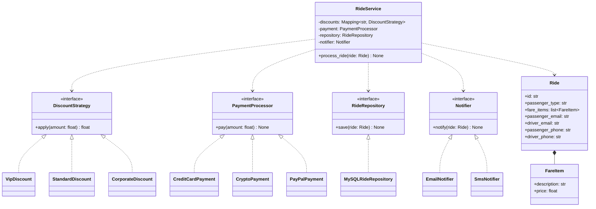

# Лабораторна робота №1. Архітектурний рефакторинг та SOLID

**Варіант 2.** Сервіс райдшерингу (`RideOrderProcessor` → `RideService`). Мова: Python 3.11, лише стандартна бібліотека (сторонніх залежностей немає).

`RideService` обробляє замовлену поїздку в п'ять кроків: валідація, розрахунок тарифу зі знижкою за типом пасажира, оплата, збереження і сповіщення водія та пасажира. Зовнішні системи (Stripe, Coinbase, PayPal, MySQL, Email, SMS) замінені на `print`, як і у вихідному коді.

Запуск:

```bash
python3.11 -m venv .venv
source .venv/bin/activate
python main.py
```

## Структура

```
lab_1/
├── legacy/order_processor.py   # вихідний код з умови (без змін)
├── ride_service/
│   ├── models.py               # Ride, FareItem
│   ├── ride_service.py         # RideService (DI через конструктор)
│   ├── discounts/
│   │   ├── base.py             # DiscountStrategy
│   │   ├── vip.py
│   │   ├── standard.py
│   │   └── corporate.py        # Завдання 3
│   ├── payments/
│   │   ├── base.py             # PaymentProcessor
│   │   ├── credit_card.py
│   │   ├── crypto.py
│   │   └── paypal.py           # Завдання 3
│   ├── notifications/
│   │   ├── base.py             # Notifier
│   │   ├── email.py
│   │   └── sms.py              # Завдання 3
│   └── repositories/
│       ├── base.py             # RideRepository
│       └── mysql.py
├── main.py
└── README.md
```

На початку кожного `.py`-файлу (крім legacy) є коментар із номером завдання і тим, за що файл відповідає.

## Завдання 1. Аналіз та Code Review

Аналізується [`legacy/order_processor.py`](legacy/order_processor.py) (код з умови). `RideOrderProcessor` з варіанту 2 має ту саму структуру, тому висновки для нього ті самі.

| Принцип | Рядки | Порушення |
|---|---|---|
| **S** (Single Responsibility) | 2–23 | Один метод виконує п'ять обов'язків: валідацію (4–5), розрахунок знижки (7–12), оплату (14–19), збереження в БД (21) і відправку повідомлення (23). Отже, клас має п'ять причин для змін. |
| **O** (Open/Closed) | 8–11, 14–19, 23 | Щоб додати тип клієнта, спосіб оплати чи канал сповіщення, доводиться редагувати сам метод і дописувати `elif` або змінювати `print`. Розширити поведінку без модифікації неможливо. |
| **L** (Liskov Substitution) | 8–11, 14–19 | Порушення непряме: замість поліморфних підтипів код перевіряє рядки. Невідомий `payment_type` мовчки пропускає оплату, а замовлення все одно зберігається і клієнт отримує повідомлення. «Варіанти» поведінки не взаємозамінні і не дотримуються спільного контракту. |
| **I** (Interface Segregation) | 1–2 | Є лише один «товстий» метод `process_order`. Клієнт, якому потрібен, наприклад, тільки розрахунок знижки, змушений залежати від усього процесу разом з оплатою, БД і Email. |
| **D** (Dependency Inversion) | 14–19, 21, 23 | Бізнес-логіка напряму залежить від конкретних деталей: Stripe і Coinbase (16, 19), MySQL (21), Email (23). Абстракцій, які можна було б підмінити, немає. |

**Чому це проблема для підтримки:**

- Будь-яка зміна (нова знижка, PayPal, SMS) зачіпає той самий метод, тож зростає ризик зламати решту кроків.
- Код неможливо протестувати ізольовано: щоб перевірити знижку, доводиться проходити через оплату, БД і Email.
- З кожним новим типом зростає ланцюжок `if/elif`, а з ним і складність методу.
- Помилки проходять мовчки: невідомий тип оплати просто не списує гроші.
- Заміна MySQL або платіжного провайдера вимагає переписувати бізнес-логіку.

## Завдання 2. Рефакторинг

- **Стратегії знижок.** `DiscountStrategy` має реалізації `VipDiscount` і `StandardDiscount`. `RideService` отримує словник `тип пасажира → стратегія`, тому сам нічого не знає про конкретні типи.
- **Інтерфейси.** Кожен компонент є окремим пакетом: інтерфейс лежить у `base.py`, а кожна реалізація у власному файлі. Це [`discounts/`](ride_service/discounts), [`payments/`](ride_service/payments), [`notifications/`](ride_service/notifications) і [`repositories/`](ride_service/repositories).
- **DI.** [`RideService`](ride_service/ride_service.py) отримує всі залежності через конструктор. Він імпортує лише `base.py` кожного пакета і `models`. Конкретні класи створюються тільки в [`main.py`](main.py) (composition root).
- **Валідація.** Поїздка без складових тарифу відхиляється з `ValueError`, як `"Order is empty"` в оригіналі. Тип пасажира без зареєстрованої стратегії платить повну ціну, як `discount = 0` в оригіналі.

## Завдання 3. Розширення (перевірка OCP)

Додано лише нові файли поруч з наявними реалізаціями. Жоден наявний клас не змінювався. Нові модулі тільки підключаються в `main.py`, бо саме для цього існує composition root.

| Вимога | Новий клас | Файл |
|---|---|---|
| Тип пасажира `Corporate`, знижка 30% | `CorporateDiscount` | `discounts/corporate.py` |
| Оплата PayPal | `PayPalPayment` | `payments/paypal.py` |
| SMS замість Email | `SmsNotifier` | `notifications/sms.py` |

Підключення в `main.py`:

```python
extended_service = RideService(
    discounts={**discounts, "Corporate": CorporateDiscount()},
    payment=PayPalPayment(),
    repository=MySQLRideRepository(),
    notifier=SmsNotifier(),
)
extended_service.process_ride(make_ride("R-2", "Corporate"))
```

```
--- Після розширення: Corporate / PayPal / SMS ---
Processing PayPal payment for 140.0
Saving ride R-2 to MySQL Database...
Sending SMS to +380674445566: Ride R-2 is confirmed.
Sending SMS to +380501112233: Your ride is processed.
```

## Завдання 4. UML-діаграма класів

`..>` позначає залежність (dependency), `<|..` позначає реалізацію інтерфейсу (realization).



`CorporateDiscount`, `PayPalPayment` і `SmsNotifier` додано в Завданні 3.

## Примітка: як це виглядало б у продакшені

- Новий тип пасажира чи спосіб оплати додається новим класом і одним рядком реєстрації в composition root (у великих проєктах це DI-контейнер або конфіг). Старі класи й тести не змінюються.
- Окремо знадобляться дані і конфігурація: значення `"Corporate"` у профілях пасажирів (можливо, міграція БД), ключі PayPal через змінні оточення, які передаються в конструктор.
- За умовою лаби спосіб оплати передається в конструктор, тобто один екземпляр сервісу відповідає одному способу оплати. У реальному сервісі пасажир обирає оплату для кожної поїздки, тому оплати передавалися б словником `спосіб → PaymentProcessor`, так само як знижки. Принцип OCP від цього не змінюється.
